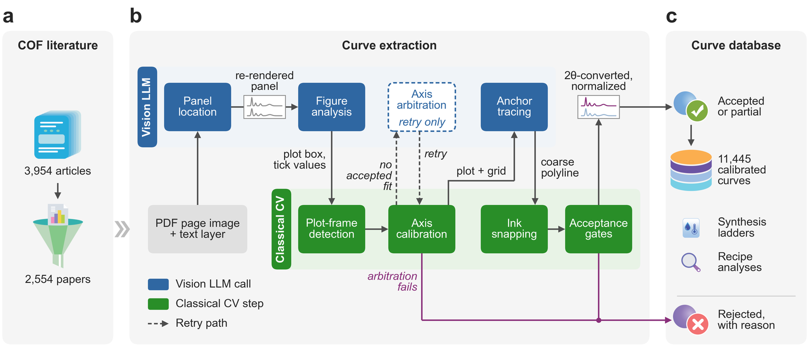

# COF-PEAK

COF-PEAK extracts powder X-ray diffraction (PXRD) curves from figures in the covalent organic framework (COF) literature and releases them as calibrated, open data.

<p align="center">
  
</p>

[Paper (arXiv)](https://arxiv.org/abs/2611.23680) | [Website](https://pxrd-peak.vercel.app) | [API](https://pxrd-peak.vercel.app/docs/api) | [Data release](https://github.com/AaronG211/pxrd_PEAK/releases/latest) | [Pipeline walkthrough](docs/pxrd_core_modules.pdf) | [Slides](docs/pxrd_pipeline_slides.html)

## How it works

A vision large language model (LLM) reads the layout of each figure. It locates the PXRD panel, lists its curves, reads the x-axis tick values and sketches a coarse trace of each curve. Classical computer vision (CV) then measures the geometry from the pixels. It calibrates the 2θ axis, snaps each sketch onto the drawn line and rejects any trace that fails a pixel check, with a recorded reason.

## Quick start

### Use the data

Download `curves.csv.gz`, `points.csv.gz` and `papers.csv.gz` from the [latest data release](https://github.com/AaronG211/pxrd_PEAK/releases/latest), then load them with pandas:

```python
import pandas as pd

curves = pd.read_csv("curves.csv.gz")
points = pd.read_csv("points.csv.gz")
papers = pd.read_csv("papers.csv.gz")

# one curve as two arrays
p = points[points.series_id == curves.series_id.iloc[0]]
x, y = p.two_theta_deg.to_numpy(), p.relative_intensity.to_numpy()
```

The release README lists every column, the admission classes and the cautions. The same curves can be searched on the [website](https://pxrd-peak.vercel.app) and queried through the read-only [API](https://pxrd-peak.vercel.app/docs/api), which needs no key.

### Run the pipeline on your own PDFs

Python 3.11 or newer is required. The pipeline calls the OpenAI API, so you need your own API key.

```bash
git clone https://github.com/AaronG211/pxrd_PEAK.git
cd pxrd_PEAK
python -m pip install -e ".[dev]"
cp .env.example .env        # then add your OpenAI API key to .env
pxrd-fetcher doctor         # checks Python, dependencies, the API key and paths
pxrd-fetcher auto path/to/article.pdf --out my_run
```

`auto` accepts one PDF or a folder of PDFs. It writes the accepted curves, the rejection reasons and an HTML report to `outputs/my_run/`. The tests run offline:

```bash
python -m pytest tests/ --ignore=tests/test_integration_sample_papers.py
```

## Choose a workflow

| Task | Start here |
| --- | --- |
| Download all 11,445 curves | [Data release](https://github.com/AaronG211/pxrd_PEAK/releases/latest) |
| Search curves by peak position or browse a paper's figures | [Website](https://pxrd-peak.vercel.app) |
| Query curves from code | [API documentation](https://pxrd-peak.vercel.app/docs/api) |
| Extract curves from your own PDFs | [Run the pipeline](#run-the-pipeline-on-your-own-pdfs) |
| Understand the pipeline step by step | [Core modules walkthrough](docs/pxrd_core_modules.pdf) and [slides](docs/pxrd_pipeline_slides.html) |
| Run or deploy the website and API | [Website README](cof_database/README.md) |

## Repository layout

| Location | Contents |
| --- | --- |
| `src/pxrd_fetcher/v2/` | The extraction pipeline: LLM calls (`llm.py`), plot frame, tick marks and ink snapping (`vision.py`), axis calibration (`calibrate.py`), traces and acceptance gates (`extract.py`), curve lists (`curves.py`) and the run loop (`pipeline.py`) |
| `src/pxrd_fetcher/` | Shared code: settings, OpenAI requests and response cache, OCR, post-processing and the command-line interface |
| `tools/` | Batch runs, database building, quality checks and analysis scripts |
| `tests/` | Automated tests of calibration, ink snapping, curve lists, post-processing and settings |
| `cof_database/` | The COF-PEAK website: API backend, web frontend, database schema and import scripts |
| `docs/` | Walkthrough of the core modules and a stage-by-stage slide deck |
| `plan/` | Design notes for the pipeline |

## Data and reproducibility

The production run processed 3,954 COF articles and kept 11,445 curves from 4,664 figures in 2,370 papers.

| File | Contents | Records |
| --- | --- | ---: |
| `curves.csv.gz` | One row per curve: source, extraction scores, axis calibration route, admission class, first peak and shape descriptors | 11,445 |
| `points.csv.gz` | One row per digitized point: `series_id`, `two_theta_deg`, `relative_intensity` | 21,859,711 |
| `papers.csv.gz` | One row per paper: DOI, title, authors, journal, year and Crossref license | 2,370 |

Every curve carries an admission class that records which checks it passed, so flagged curves are disclosed, not removed. Use `clean` curves for analyses of absolute peak positions. Rendering, OCR, CV and post-processing are deterministic; the LLM's answers are part of the data. The files contain no figure images, so open the source article through the `doi` column to see a curve's figure.

## Citation and license

The accompanying article is available as a preprint on arXiv: [arXiv:2611.23680](https://arxiv.org/abs/2611.23680).

```bibtex
@misc{gao2026cofpeak,
  title         = {Structured Extraction of Diffraction Data from Covalent Organic Frameworks},
  author        = {Gao, Shenghan and Zheng, Zhiling},
  year          = {2026},
  eprint        = {2611.23680},
  archivePrefix = {arXiv},
  primaryClass  = {cs.CV},
  doi           = {10.48550/arXiv.2611.23680},
  url           = {https://arxiv.org/abs/2611.23680}
}
```

Citation metadata is provided in [CITATION.cff](CITATION.cff). The code uses the [MIT License](LICENSE). The curves, points and metadata are released under CC BY 4.0. Please also cite the source article of every curve you use.
